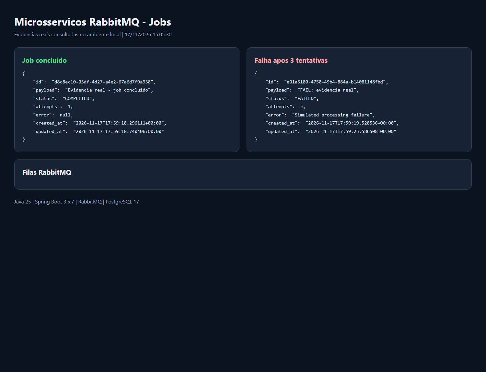

# Microsserviços RabbitMQ — Fila de Jobs

Projeto 13/52 | Java 25, Spring Boot 3.5.7, RabbitMQ, PostgreSQL 17, Docker Compose.

## Arquitetura

- `producer`: API HTTP (porta 8083), grava jobs e publica mensagens.
- `worker`: consumidor com ACK manual, tentativas e DLQ.
- `common`: contrato JSON e nomes das filas.
- PostgreSQL: estados `PENDING`, `PROCESSING`, `COMPLETED`, `FAILED`.

## Executar

```powershell
docker compose up -d
mvn -B clean verify
mvn -pl producer -am spring-boot:run
# Em outro terminal:
mvn -pl worker -am spring-boot:run
```

`POST http://localhost:8083/api/jobs` com `{"payload":"hello"}` retorna `202` e `id`.
`GET http://localhost:8083/api/jobs/{id}` consulta estado.
Payload iniciado por `FAIL:` simula falha, três tentativas e envio à DLQ.
RabbitMQ UI: http://localhost:15673 (jobs/jobs).

## Limitações técnicas importantes

Este é um **MVP de infraestrutura**, não um sistema de entrega garantida: gravação no banco e publicação RabbitMQ ainda não são atômicas; a publicação não espera confirmação de broker; falhas entre publicação e ACK podem gerar reentrega; tarefas travadas em `PROCESSING` não têm recuperação automática; o efeito externo é apenas simulado. Para produção, implementar transactional outbox, confirms, recuperação de leases, idempotência de efeitos externos e testes de integração com falhas injetadas.

## Evidência real de funcionamento



A captura apresenta dados reais consultados no PostgreSQL e,
quando disponível, na API de gerenciamento do RabbitMQ.

O processamento bem-sucedido terminou com COMPLETED em uma tentativa.
O cenário FAIL: terminou com FAILED após três tentativas.
